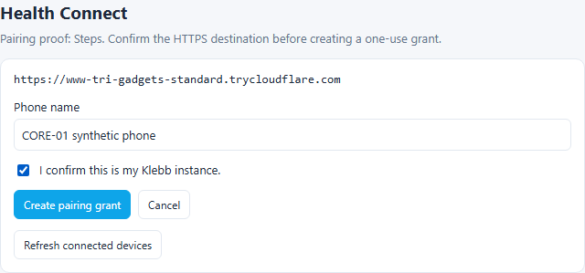
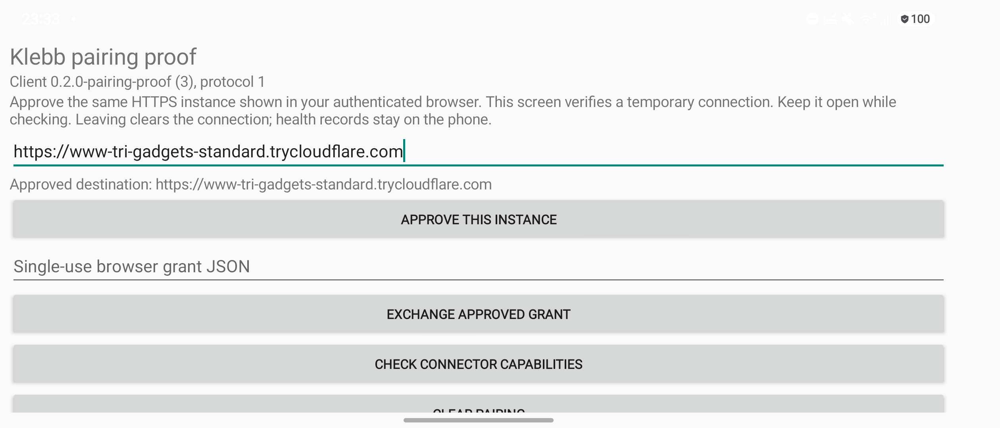

# Controlled browser and phone pairing evidence

The CORE-01 proof used an isolated synthetic instance and the actual Samsung
phone. It did not read Health Connect records or upload personal history.
The temporary HTTPS origin is a test endpoint, not an installation link.

| Component | Observed version or fingerprint |
|---|---|
| Server authority | Reviewed `66d1ad1c5edaad75cf79feef3e4d81ce58740dd4`, merged as `9806cf0674a72cf16889362b10898aab77f09e45` |
| Android package | `app.klebb.companion`, version code 3, `0.2.0-pairing-proof`, protocol 1 |
| APK SHA-256 | `1013c44045398ef299ae29c49d01a1897b1cd681c3debb9c6d4208fac074f4b3` |
| Retained signing certificate SHA-256 | `8375a2de5555bb7884324a7c6d3f6ab3d07d77bb1ce3b01e9621c99850bfac62` |
| Phone | Samsung SM-F776B, Android 17 / API 37, One UI 9 |
| Phone build | `CP2A.260605.016.F776BXXS2AZIH`, security patch 2026-10-05 |
| Pinned Health Connect SDK | `1.2.0-alpha06`; no Health Connect calls in this pairing activity |

The release-signed APK updated the existing installation in place without
uninstalling or changing the signing identity. Its shared schema is the same
reviewed server contract. The Android source was frozen after 110 passing
JUnit checks, lint and scoped review.

The browser registered through the existing WebAuthn ceremony using a
Chromium virtual authenticator, then used the real authenticated session and
rendered settings. This establishes the actual server ceremony and session;
it is not a physical biometric or phone passkey observation. Neither client
bypassed certificate or hostname verification. No response interception,
cookie injection or loopback route bridge was used.

Both screens showed the same destination before exchanging authority:

| Controlled action | Independent expectation | Actual observation, UTC 2026-10-28 |
|---|---|---|
| Expired initial browser grant | Refuse locally before sending authority | 12:33:31: phone shows the expired-grant result; no exchange request |
| Alter only the instance UUID in a fresh grant | 403 and no grant consumption | 12:34:52: real exchange 403, connection cleared |
| Use the unchanged original fresh grant | 200 and consume one scoped response | 12:35:46: real exchange 200; phone shows connected |
| Check connector capabilities | 200 and validate binding/scope | 12:35:55: real capabilities 200; phone confirms verification |
| Check Steps stream status | 200 with the approved generation/epoch | 12:36:01: real stream status 200; phone confirms authorisation |
| Revoke through authenticated browser | Revoke the listed connector | 12:36:40: real DELETE 200, list shows revoked |
| Use the revoked connection | 401 and clear memory state | 12:36:52: real capabilities 401; phone shows refusal and cleared pairing |
| Replay the consumed grant before expiry | 409, no additional connector | 12:37:20: real exchange 409; phone shows refusal |
| Leave and reopen a second controlled connection | Clear authority on pause; no further request | 12:42:33: phone shows lifecycle clearing; attempted capability check sends no request |
| Cleanup | Revoke every controlled connector, clear phone state | Both listed synthetic connectors revoked; no health records created |

Server observations recorded only a fixed route, method, response status and
timestamp. They did not read request headers/bodies or response bodies.
Screenshots omit grant/credential values. ADB's original screenshot stream
included a multiple-display warning before the PNG; the retained PNG is the
unchanged image byte sequence after that warning. Later captures selected
the primary display explicitly.

Transport tests separately used real controlled HTTPS handlers to establish
zero authority forwarding on redirects, untrusted certificates and wrong
hostnames. Shared valid/adversarial fixtures and independently expected
timestamp, canonical-origin, connector-binding and cancellation cases pass.

This proves the narrow protocol and foreground connection boundary. Durable
credentials, permission/date/network setup, serializers, queued capture,
saved-history ACKs, native watch sync and release/soak readiness keep their
separate ticket gates.
